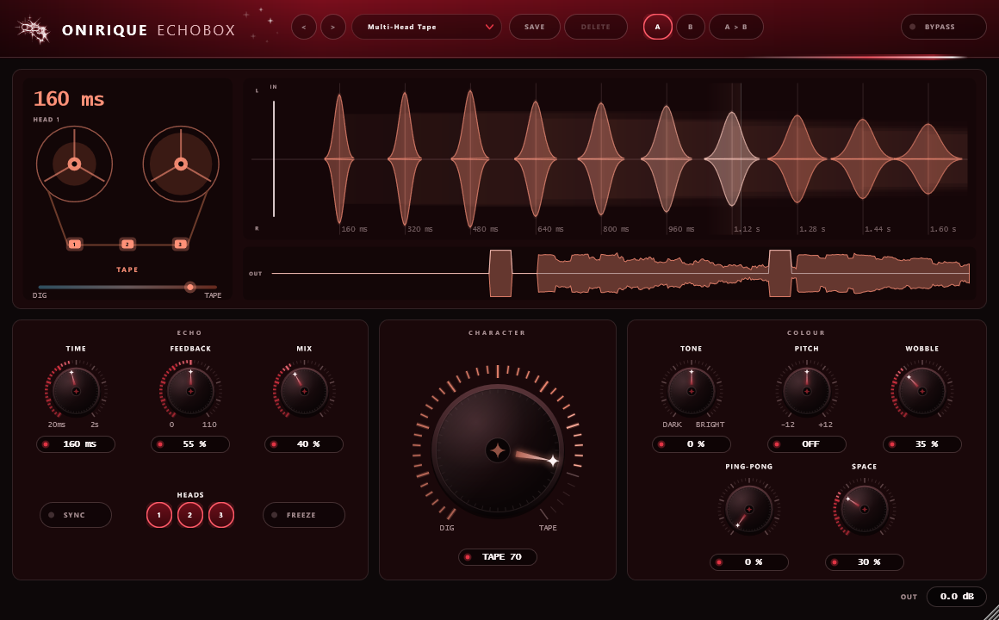

# Onirique EchoBox

Un delay créatif qui voyage, d'un seul bouton, du numérique le plus électrique à
la bande la plus usée : en passant par une machine 12 bits à pitch shifter dans
l'esprit des delays numériques de studio des années 80, un numérique parfaitement
propre, et l'écho à bande chaud, à une tête ou multi-têtes.

VST3 (Windows, macOS) et Audio Unit (macOS). Entrée mono ou stéréo, sortie
stéréo. Aucune latence. « EchoBox » est un nom provisoire.



---

## Les réglages

| Famille | Réglage | Ce qu'il fait |
|---|---|---|
| ECHO | Time | le temps de la tête 1, 20 ms à 2 s ; avec **Sync**, une valeur de note (1/32 à 1/1, pointées, triolets) |
| | Feedback | 0 à 110 % ; au-delà de 100, l'écho s'emballe et chante seul |
| | Mix | sec seul (0) à échos seuls (100), les deux à plein au milieu |
| | Heads 1 2 3 | les têtes de lecture, à une, deux et trois fois le temps, combinables |
| | Freeze | fige la bande et la fait tourner en boucle, sans perte |
| CHARACTER | Character | DIG ⟷ TAPE : électrique · 12 bits · propre · bande · bande usée |
| COLOUR | Tone | répétitions de plus en plus sombres, ou plus brillantes et fines |
| | Pitch | chaque répétition monte ou descend de -12 à +12 demi-tons, en cascade |
| | Wobble | pleurage et scintillement côté bande, sauts d'horloge côté numérique |
| | Ping-Pong | les répétitions passent d'un côté à l'autre |
| | Space | la réverbe où tombent les échos, en ressort côté bande |

## Le Character, en détail

Le bouton se lit en deux moitiés.

- **0 → 50 (numérique)** : les répétitions sont réenregistrées sur de moins en
  moins de bits (16 au milieu, 12 au quart, 7 tout à gauche) et à une fréquence de
  plus en plus basse (jusqu'à 7 kHz, sans filtre : le repliement fait partie du
  son). Le filtre de la boucle se resserre vers 12,5 kHz au quart, comme les
  convertisseurs d'époque, puis se rouvre tout à gauche. Le temps change presque
  instantanément.
- **50 → 100 (bande)** : la tête d'enregistrement sature de plus en plus, chaque
  répétition perd des aigus (jusqu'à 2,6 kHz) et des graves, un léger souffle
  s'installe, le temps glisse en faisant plier la hauteur quand on le tourne, et
  le Space prend le son d'un ressort.

Le Wobble change de nature avec lui : pleurage lent, scintillement rapide et
dérive au hasard côté bande ; valeurs tenues et sautées côté numérique.

## L'écran

- **À gauche, la machine** : une puce mémoire dont les cellules s'écrivent en
  boucle côté numérique, deux bobines qui tournent à la vitesse de la bande côté
  analogique, les trois têtes allumées quand elles lisent, le temps en clair, et
  la position du Character entre DIG et TAPE.
- **À droite, les répétitions** qu'un son va produire : une marque par écho, à
  sa place dans le temps et aussi haute qu'il revient fort ; la gauche au-dessus de
  l'axe, la droite en dessous (un ping-pong se voit croiser). Barres nettes et
  crantées en numérique, bosses douces qui s'élargissent en bande. Avec Pitch, un
  escalier en haut indique la hauteur de chaque écho. Un curseur part de la
  dernière note jouée et allume chaque écho quand il sonne.
- **En bas**, ce qui vient d'entrer (ligne blanche) et de sortir.

---

## État du projet

| Partie | État |
|---|---|
| Moteur (trois têtes, boucle, numérique/bande, pitch, freeze, space) | fait, testé hors ligne (`test_echo`) |
| A/B, presets stock et utilisateur, état sauvegardé, sync | fait, testé hors ligne (`echobox_snapshot --selftest`) |
| Plugin VST3, paramètres automatisables | compile sous Windows |
| Interface | écrite, vérifiée sur capture (`echobox_snapshot`) |
| Licence ONIRIQUE (`onirique-echobox`) | intégrée ; aucun produit de ce nom au catalogue pour l'instant |
| Écoute dans un DAW | **pas encore faite** |

Le moteur a été mesuré sur des signaux de synthèse, pas écouté. Les réglages par
défaut et les presets stock ont été posés par raisonnement : ils restent à
ajuster à l'oreille.

---

## Construire

JUCE 9.0.3 est cherché dans `JUCE/`, puis dans `../PitchBox/JUCE` : les plugins
de la gamme partagent la même copie.

```bash
cmake -B build -A x64
cmake --build build --config Release --parallel
ctest --test-dir build -C Release --output-on-failure
```

Le plugin sort dans `build/OniriqueEchoBox_artefacts/Release/VST3/EchoBox.vst3`.

Une capture de l'interface, sans hôte :

```bash
cmake --build build --config Release --target echobox_snapshot
build/Release/echobox_snapshot capture.png "Multi-Head Tape"
```

Sur GitHub, chaque push construit Windows et macOS ; les plugins sont déposés sur
les branches `ci-build-Windows` et `ci-build-macOS`, les journaux sur `ci-logs-*`.

`License/` est copié tel quel de `plugin-license/` du dépôt ONIRIQUE CENTRAL, et
`Source/ui/OniriqueKnob.h` / `OniriqueWindowSize.h` de `plugin-ui/` : ils ne se
modifient que là-bas.
